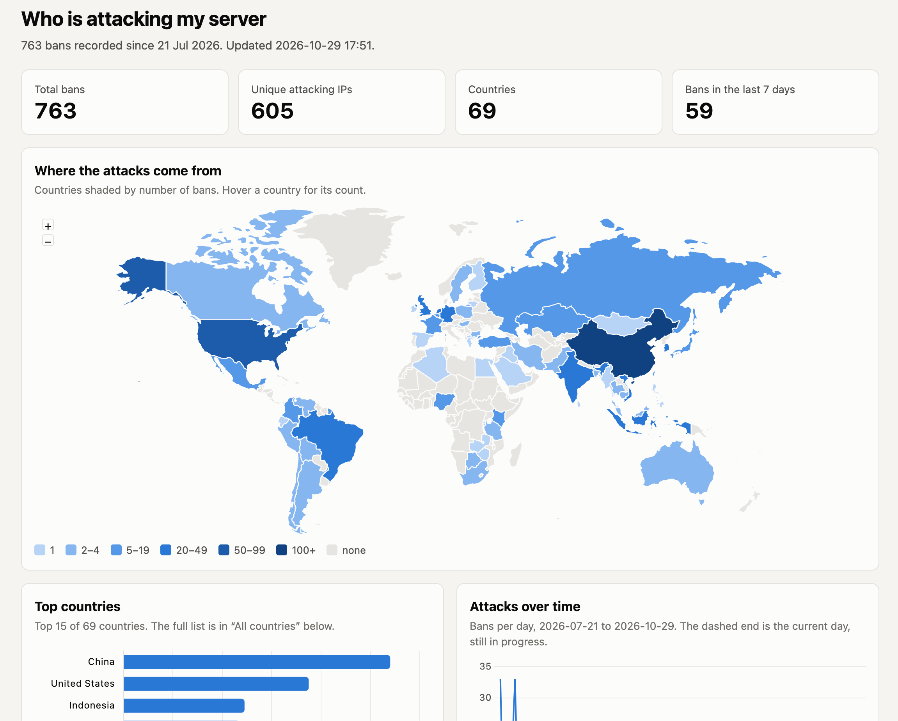

# AttackMap

Reads fail2ban's ban emails from an IMAP mailbox, works out which country each banned IP
is in, and writes a static web page with:

- a world map shaded by number of bans
- a bar chart of the top countries
- a chart of bans over time (daily, switching to weekly once you have 4+ months of history)
- a table of the top attacking IP addresses, plus a full country table

It keeps an all-time history in a small JSON file, so each run only reads new emails and
never changes or deletes anything in the mailbox.



## 1. Install .NET 10

.NET 10 is the current long-term support release (supported until November 2028).
On Ubuntu 24.04 or later:

```bash
sudo apt install dotnet-sdk-10.0
```

(For Debian or other distros, see https://learn.microsoft.com/dotnet/core/install/linux.)

## 2. Build it

From this folder:

```bash
dotnet publish -c Release -o /opt/attackmap
```

That puts the program at `/opt/attackmap/attackmap`. Make sure the user that will run it
owns that folder, e.g. `sudo chown -R $USER /opt/attackmap`.

## 3. Get a free IP-to-country database

Either one works; the program reads both.

- **DB-IP Lite** (no account needed): download "IP to Country Lite" in **MMDB** format from
  https://db-ip.com/db/download/ip-to-country-lite, unzip it (`gunzip`), and save it as
  `/opt/attackmap/dbip-country-lite.mmdb`. The licence asks for a credit line, which the
  example config already puts in the page footer. A new version comes out monthly.
- **MaxMind GeoLite2 Country** (free account needed): sign up at maxmind.com, then
  download `GeoLite2-Country.mmdb`. MaxMind's `geoipupdate` tool can keep it current
  automatically.

If you went with DB-IP Lite, `update-geoip.sh` automates the monthly download: it fetches
the current month's file (falling back to last month's if this month's isn't out yet),
checks the download is a real database before using it, and saves it to
`/opt/attackmap/dbip-country-lite.mmdb`. Copy it to `/opt/attackmap`, make it executable
(`chmod +x update-geoip.sh`), and schedule it in cron, e.g. once a month on the 3rd
(giving DB-IP a couple of days to publish that month's file):

```
15 4 3 * * /opt/attackmap/update-geoip.sh >> $HOME/update-geoip.log 2>&1
```

## 4. Configure

```bash
cd /opt/attackmap
cp appsettings.example.json appsettings.json
chmod 600 appsettings.json    # it holds your mail password
nano appsettings.json
```

The settings that matter most:

| Setting | What to put |
|---|---|
| `Imap.Host`, `Port`, `Security` | Your mail provider's IMAP details. Usually port 993 with `SslOnConnect`. |
| `Imap.Username`, `Password` | Your mailbox login. Some providers need an app password. |
| `Imap.SenderFilter` | The From address of fail2ban's emails (the `sender` in your fail2ban `jail.local`). |
| `GeoIpDatabase` | The .mmdb file from step 3. |
| `OutputFile` | Where the page goes, inside your web server's public folder, e.g. `/var/www/html/attacks/index.html`. |

The user running the program needs write access to the `OutputFile` folder:

```bash
sudo mkdir -p /var/www/html/attacks
sudo chown $USER /var/www/html/attacks
```

## 5. Run it once by hand

```bash
/opt/attackmap/attackmap
```

You should see something like:

```
2026-10-29 01:25:07 Checked mail: 14 new email(s), 11 ban(s) added, 2 skipped. History now holds 11 ban(s).
2026-10-29 01:25:07 Wrote /var/www/html/attacks/index.html
```

"Skipped" emails are ones with no ban in them, usually fail2ban's "jail started/stopped"
notices. Their subjects are printed so you can check nothing real was missed.

Other options:

- `--rebuild` regenerates the page from the saved history without checking mail.
- `--rescan` forgets the history and re-reads every matching email from scratch.
- `--config /path/to/file.json` uses a different settings file.
- `--list-folders` connects and prints every IMAP folder's full name and hierarchy delimiter.
  Use this if you want fail2ban's emails to go to a subfolder instead of `INBOX` — set
  `Imap.Folder` to the exact name printed here (the delimiter between parts varies by
  mail server, e.g. `/` or `.`).

## 6. Schedule it with cron

Run `crontab -e` and add a line. This one runs every 15 minutes:

```
*/15 * * * * /opt/attackmap/attackmap >> $HOME/attackmap.log 2>&1
```

If a run is still going when the next one starts, the second one exits straight away.

## 7. Show it in WordPress

The page is at `https://yoursite.com/attacks/`. To put it inside a WordPress page, add a
**Custom HTML** block containing:

```html
<iframe src="/attacks/" title="Server attack map" loading="lazy"
        style="width:100%;height:2400px;border:0"
        onload="this.style.height=this.contentWindow.document.documentElement.scrollHeight+'px'"></iframe>
```

Because the page is on the same site as WordPress, the `onload` part sizes the frame to fit
the page exactly. If WordPress strips it (it does for non-admin editors), the fixed height
still works. You can also simply link to `/attacks/`.

## How the emails are read

fail2ban's standard mail actions send a subject like
`[Fail2Ban] sshd: banned 203.0.113.7 from myserver`, which is read without downloading the
message. If a subject doesn't match, the body is checked for fail2ban's standard
"The IP ... has just been banned" line. Body text from the whois variants (which lists
other IP addresses) is never mistaken for the attacker. IPv4 and IPv6 both work.

If your fail2ban emails use a custom format and get reported as skipped, the matching
patterns are at the top of `Fail2BanParser.cs`. After changing them, run with `--rescan`.

## Files

| File | Purpose |
|---|---|
| `Program.cs` | Command-line options, locking, and the overall run |
| `Config.cs` | Settings |
| `MailFetcher.cs` | Reads new fail2ban emails over IMAP (read-only) |
| `Fail2BanParser.cs` | Pulls the IP and jail name out of each email |
| `GeoLookup.cs` | IP-to-country lookup |
| `StateStore.cs` | Saves and loads the all-time history |
| `ReportBuilder.cs` | Builds the HTML page |
| `update-geoip.sh` | Monthly cron script to refresh the DB-IP Lite database |

The page loads Chart.js and jsvectormap from the jsDelivr CDN, with integrity hashes so a
tampered copy would be refused.
